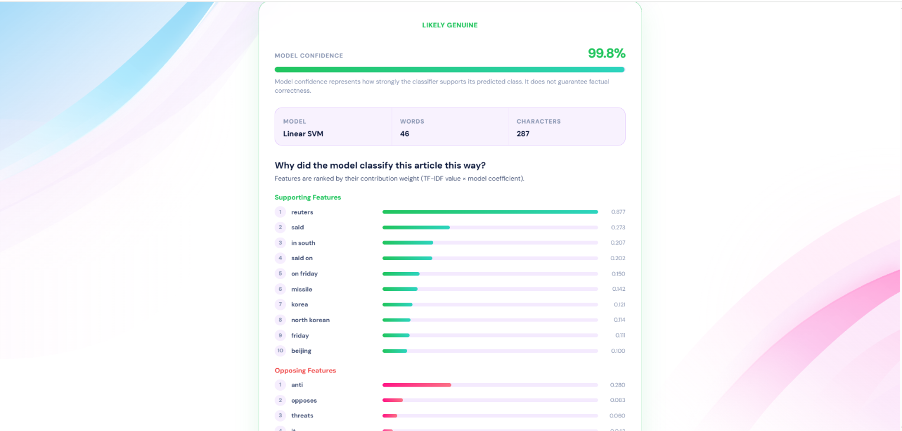
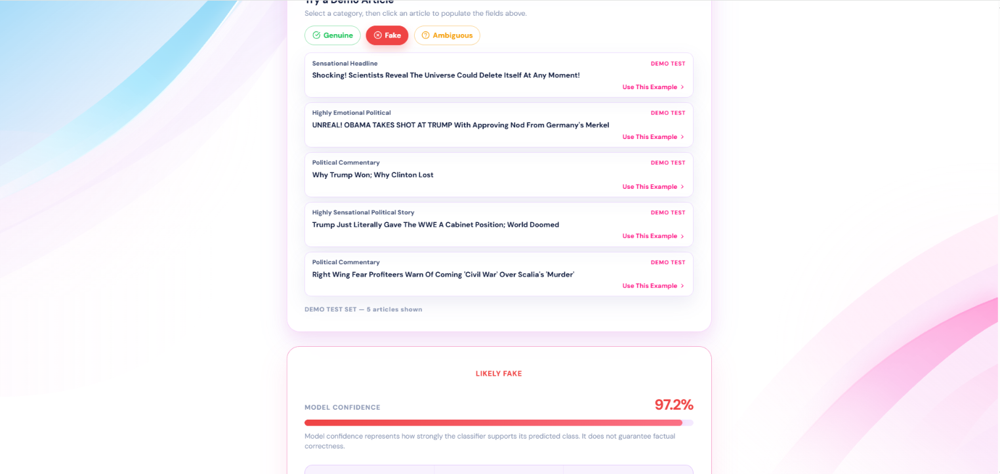
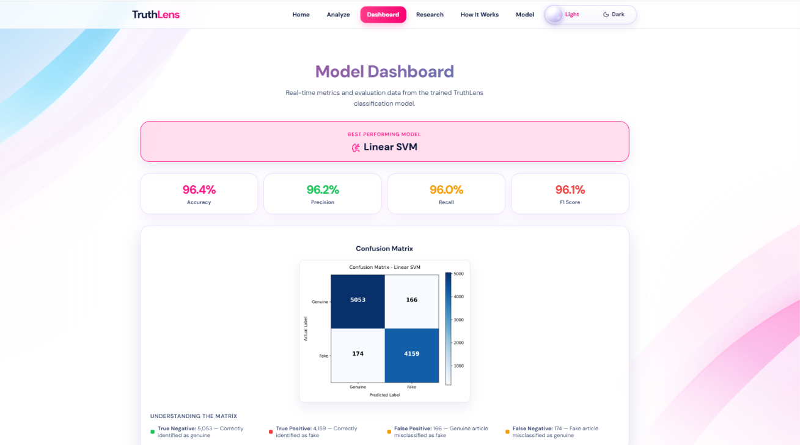
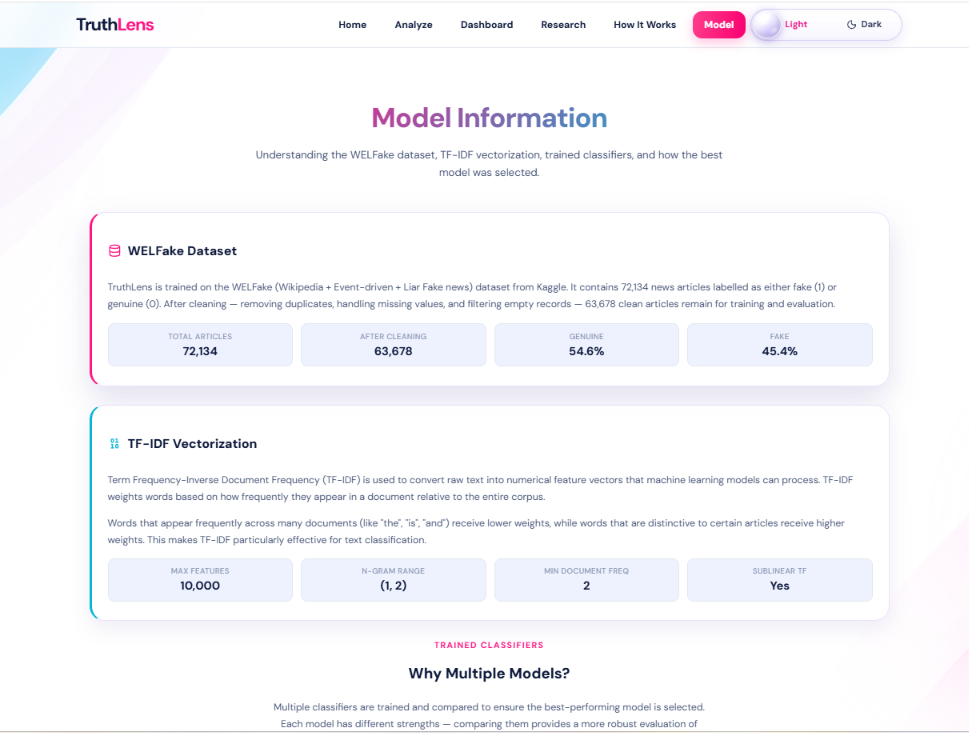
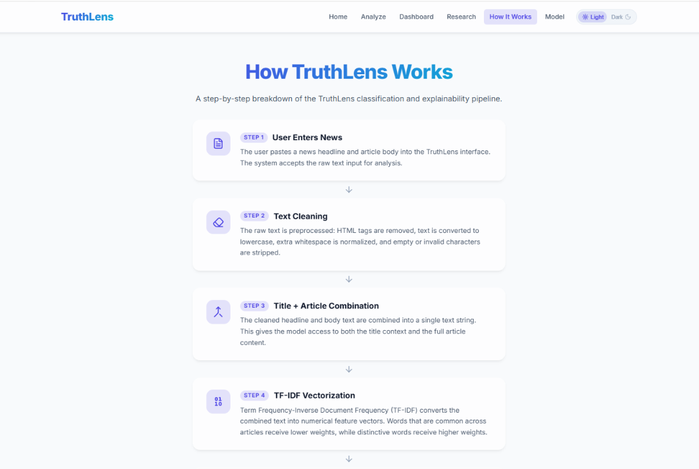
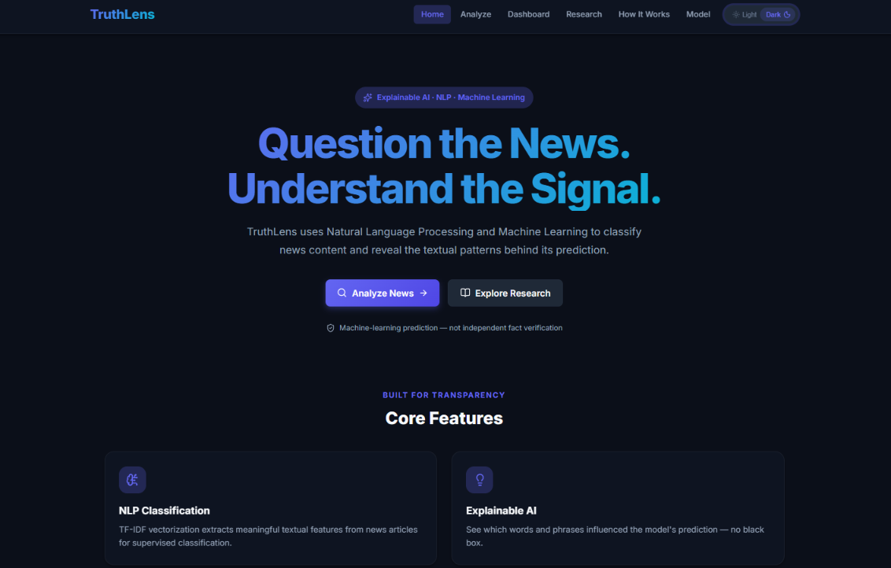

# TruthLens

### AI-Based Fake News Classification & Explainable Analysis System

> **Question the News. Understand the Signal.**

TruthLens is an NLP and Machine Learning based system that classifies news articles as **Likely Genuine** or **Likely Fake** and provides explainable textual features behind the prediction. It uses TF-IDF vectorization, multiple supervised classifiers, and Explainable AI to reveal which words and phrases influenced the model's decision.

TruthLens is **not** an independent fact-checking system. It predicts based on patterns learned from labelled training data.

---

## Live Demo

- **Frontend:** https://truth-lens-omega-nine.vercel.app/
- **Backend API:** https://truthlens-backend-xtl2.onrender.com/
- **Health Check:** https://truthlens-backend-xtl2.onrender.com/api/health
- **API Documentation:** https://truthlens-backend-xtl2.onrender.com/docs

---

## Key Features

- NLP-based Fake News Classification
- TF-IDF Feature Extraction (unigrams & bigrams)
- Three trained classifiers:
  - Logistic Regression
  - Multinomial Naive Bayes
  - Linear SVM
- Model comparison with Accuracy, Precision, Recall, and F1-Score
- Best model selection based on validation performance
- Explainable AI with supporting and opposing feature contributions
- Confusion matrix visualization
- Research Dashboard with dataset statistics and feature importance
- Light / Dark mode toggle
- FastAPI backend with ML inference
- React + Vite frontend
- REST API for news analysis
- Health monitoring endpoint
- Git LFS support for the large dataset

---

## How It Works

```text
News Article
      ↓
Text Cleaning
      ↓
Title + Body Combination
      ↓
TF-IDF Vectorization
      ↓
Machine Learning Classification
      ↓
Confidence Calculation
      ↓
Explainable AI
      ↓
Result + Important Features
````

The user enters a news headline and article body. The text is cleaned, combined, and converted into TF-IDF feature vectors. The trained classifier predicts the class and a confidence score. Feature contribution analysis then identifies the words that most supported or opposed the prediction.

---

## Screenshots

### Home Page


### Analyze — Genuine News



### Analyze — Fake News



### Explainable AI & Feature Importance



### Research Methodology


### Model Information



### How It Works



### Dark Mode



---

## Technology Stack

### Frontend

| Technology   | Purpose                           |
| ------------ | --------------------------------- |
| React        | UI framework                      |
| Vite         | Build tool and development server |
| JavaScript   | Application logic                 |
| CSS          | Styling with CSS variables        |
| Lucide React | Icon library                      |
| Recharts     | Chart visualizations              |

### Backend

| Technology | Purpose                         |
| ---------- | ------------------------------- |
| Python     | Server-side language            |
| FastAPI    | REST API framework              |
| Uvicorn    | ASGI server                     |
| Pydantic   | Request and response validation |

### Machine Learning

| Technology              | Purpose                    |
| ----------------------- | -------------------------- |
| Scikit-learn            | Machine Learning framework |
| TF-IDF                  | Text feature extraction    |
| Logistic Regression     | Classification model       |
| Multinomial Naive Bayes | Classification model       |
| Linear SVM              | Best classification model  |

### Explainability

Feature importance and textual feature contribution analysis are performed using model coefficients and TF-IDF weights.

For each prediction, TruthLens extracts:

* Supporting features
* Opposing features
* TF-IDF values
* Model coefficient contributions
* Prediction confidence

---

## ML Pipeline

1. **Dataset Preparation** — Load the WELFake dataset containing 72,134 articles.
2. **Missing Value Handling** — Fill missing title/text values and remove completely empty records.
3. **Duplicate Removal** — Remove duplicate title and article-text combinations.
4. **Text Cleaning** — Convert text to lowercase, remove HTML tags, and normalize whitespace.
5. **Title + Body Combination** — Combine the headline and article body.
6. **Stratified Split** — Split the dataset into training, validation, and test sets.
7. **TF-IDF Vectorization** — Use 10,000 features with unigrams and bigrams.
8. **Model Training** — Train Logistic Regression, Multinomial Naive Bayes, and Linear SVM.
9. **Model Comparison** — Compare models using Accuracy, Precision, Recall, and F1-Score.
10. **Best Model Selection** — Select the model with the strongest validation performance.
11. **Test Evaluation** — Evaluate the selected model on the held-out test dataset.
12. **Feature Importance** — Extract global and local feature contributions.
13. **Model Deployment** — Serve predictions through a FastAPI backend.
14. **Frontend Integration** — Connect the React frontend with the deployed API.

---

## Dataset

TruthLens uses the **WELFake Dataset** containing approximately **72,134 news articles**.

To reduce repository size, the raw dataset is stored as a compressed ZIP file:

```text
dataset/raw/WELFake_Dataset.zip
```

The ZIP contains:

```text
WELFake_Dataset.csv
```

The original CSV contains:

* `title`
* `text`
* `label`

The dataset is stored using **Git Large File Storage (Git LFS)**.

### Dataset Preparation

After cloning the repository and installing Git LFS:

```bash
git lfs install
git lfs pull
```

Then run:

```bash
python -m ml.preprocessing.prepare_dataset
```

This creates:

```text
dataset/processed/
├── train.csv
├── validation.csv
└── test.csv
```

The processed datasets are generated locally and are not stored in the Git repository.

---

## Model Evaluation

### Validation Set Comparison

| Model                   |   Accuracy |  Precision |     Recall |   F1-Score |
| ----------------------- | ---------: | ---------: | ---------: | ---------: |
| Logistic Regression     |     0.9580 |     0.9522 |     0.9555 |     0.9538 |
| Multinomial Naive Bayes |     0.8592 |     0.8239 |     0.8770 |     0.8496 |
| **Linear SVM**          | **0.9672** | **0.9651** | **0.9626** | **0.9638** |

### Best Model — Linear SVM

| Metric    |  Value |
| --------- | -----: |
| Accuracy  | 0.9644 |
| Precision | 0.9616 |
| Recall    | 0.9598 |
| F1-Score  | 0.9607 |

### Confusion Matrix

|                    | Predicted Genuine | Predicted Fake |
| ------------------ | ----------------: | -------------: |
| **Actual Genuine** |        5,053 (TN) |       166 (FP) |
| **Actual Fake**    |          174 (FN) |     4,159 (TP) |

---

## Research Objectives

1. Develop a Machine Learning-based fake-news classification system.
2. Use NLP techniques for processing news text.
3. Apply TF-IDF for feature extraction.
4. Train multiple supervised Machine Learning models.
5. Compare model performance.
6. Select the best-performing practical model.
7. Use Explainable AI to identify important textual features.
8. Develop a user-friendly web application.
9. Evaluate the system using standard classification metrics.
10. Clearly communicate the limitations of automated fake-news classification.

---

## Research Question

> How effectively can NLP-based Machine Learning models classify fake and genuine news using textual features, and how can Explainable AI help users understand the model's predictions?

---

## Disclaimer

TruthLens provides a machine-learning-based classification based on patterns learned from labelled training data.

It does **not** independently verify factual claims.

Predictions may be incorrect, so important information should always be verified using reliable independent sources.

TruthLens is **not an independent fact-checking system**. It is an academic research project demonstrating NLP-based text classification with explainable AI.

---

## Project Structure

```text
TruthLens/
│
├── backend/
│   └── app/
│       ├── main.py
│       ├── routes/
│       ├── services/
│       ├── ml/
│       ├── schemas/
│       └── utils/
│
├── frontend/
│   └── src/
│       ├── components/
│       ├── pages/
│       ├── hooks/
│       ├── services/
│       └── utils/
│
├── ml/
│   ├── artifacts/
│   ├── results/
│   ├── preprocessing/
│   ├── training/
│   ├── evaluation/
│   └── explainability/
│
├── dataset/
│   ├── raw/
│   │   └── WELFake_Dataset.zip
│   └── processed/
│
├── scripts/
│
├── screenshots/
│   ├── home.png
│   ├── analyze-genuine.png
│   ├── analyze-fake.png
│   ├── dashboard.png
│   ├── research.png
│   ├── model.png
│   ├── how-it-works.png
│   └── dark-mode.png
│
├── .gitattributes
├── .gitignore
├── README.md
└── requirements files
```

---

## Getting Started

### Prerequisites

* Python 3.9+
* Node.js 18+
* npm
* Git
* Git LFS

### Clone Repository

```bash
git clone https://github.com/mash157/Truth-Lens.git
cd Truth-Lens
```

### Initialize Git LFS

```bash
git lfs install
git lfs pull
```

---

## Backend Setup

Install Python dependencies:

```bash
pip install -r backend/requirements.txt
```

Start the backend:

```bash
python -m uvicorn backend.app.main:app --reload --port 8000
```

Backend:

```text
http://localhost:8000
```

FastAPI documentation:

```text
http://localhost:8000/docs
```

Health endpoint:

```text
http://localhost:8000/api/health
```

---

## Frontend Setup

Open a new terminal:

```bash
cd frontend
npm install
npm run dev
```

Frontend:

```text
http://localhost:5173
```

---

## Production Deployment

TruthLens is deployed using separate frontend and backend services.

### Frontend

The React + Vite frontend is deployed on **Vercel**.

```text
https://truth-lens-omega-nine.vercel.app/
```

### Backend

The FastAPI + Machine Learning backend is deployed on **Render**.

```text
https://truthlens-backend-xtl2.onrender.com/
```

### API Documentation

```text
https://truthlens-backend-xtl2.onrender.com/docs
```

### Health Check

```text
https://truthlens-backend-xtl2.onrender.com/api/health
```

---

## API

### Health Check

```http
GET /api/health
```

Used to verify that the backend service is running.

### News Analysis

```http
POST /api/analyze
```

Example request:

```json
{
  "title": "Government announces new education policy",
  "text": "The government announced a new education policy after consultations with schools, universities and education experts."
}
```

The API returns information including:

* Prediction
* Confidence
* Model name
* Supporting features
* Opposing features
* Word count
* Character count
* Disclaimer

---

## Author

Made With ❤️ by **@mash157**

© All Rights Reserved 2026

````

After replacing your existing README with this, run:

```powershell
cd C:\Users\USER\Downloads\TruthLens
git add README.md
git commit -m "Update README with live deployment links"
git -c core.hooksPath=NUL push origin master --force
````
